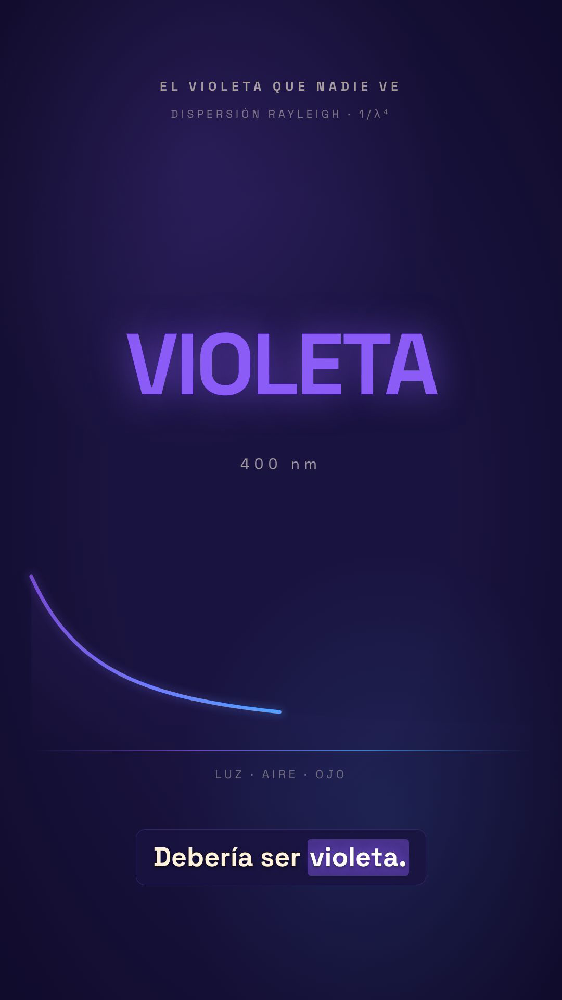

# QA y lanzamiento — F9

> Fecha: 2026-10-26 · Build: `5febaeb` (rama `cabina`) · Entorno: producción Hostinger VPS 2 vCPU / 8 GB / 100 GB.

## 1. Resultado ejecutivo

**GO para beta interna.** El pipeline completo produce un MP4 real de 45 s en 9:16 con audio, desde una idea hasta render, pasando por todos los gates. Quedan tres acciones manuales antes de abrir a usuarios externos: rotar claves, conectar un webhook real y ensayar el restore/rollback.

## 2. Matriz de pipelines

| Pipeline | Estado | Evidencia |
|---|---|---|
| animated-explainer | **E2E completo** ✅ | 10 escenas → MP4 45 s con audio |
| animation | Contratos + API ✅ / render E2E ⏳ | suite completa; falta corrida real |
| cinematic | Contratos + API ✅ / render E2E ⏳ | suite completa; requiere assets de video externos |

## 3. Tests

| Suite | Resultado |
|---|---|
| API (`tests/api`) | **24 passed** |
| Suite completa (`tests/`) | **2224 passed**, 12 skipped, 3 xfailed, **3 failed por entorno local** |
| Contratos de artefactos / schemas | ✅ |
| E2E real | ✅ ver §3 |

Los 3 fallos son de la Mac local (Homebrew FFmpeg sin `libass` y sin `libvorbis`): subtítulos y contenedor OGG. En la imagen Debian de producción FFmpeg incluye ambos; no afectan el deploy.

## 4. E2E real — `modelo-real-2`

| Etapa | Estado | Tiempo | Costo real |
|---|---|---|---|
| research | completed | — | $5.1603 (estimación histórica pre-fix) |
| proposal | completed | ~15 min (incluye job colgado previo) | $0.0896 |
| script | completed | 42 s | $0.0277 |
| scene_plan | completed (10 escenas) | 353 s | $0.1667 |
| assets | completed (6 narraciones Piper) | 4 m 48 s | $0.0467 |
| edit | completed | 3 m 33 s | $0.0480 |
| compose | completed | 10 m 38 s | $0.0949 |
| publish | **awaiting_human** · export generado en `exports/modelo-real-2` | — | $0 |

**Render final:** `renders/modelo-real-2.mp4` (el `render_report` reporta 213,4 s de render puro; el job completo tardó 10 m 38 s incluyendo verificación)

```
duración   45.056 s
video      h264 · 1080x1920 · 30 fps
audio      aac · 48 kHz · estéreo
tamaño     6.844.995 bytes (6,5 MB)
bitrate    1,22 Mbps
```



Costo incremental real del E2E (sin la estimación vieja de research): **≈ $0,474**.

## 5. Checks funcionales

- [x] Login por cuenta y por token; logout invalida sesión.
- [x] Crear producción, biblioteca, posters y estados.
- [x] Board de 3 columnas, stage rail y gates con nota.
- [x] Aprobar/rechazar gates y auto-chain al siguiente stage.
- [x] Storyboard con 10 escenas, drag & drop persistido, drawer y regeneración.
- [x] Timeline (video/audio/captions) y renders con player.
- [x] Chat, decisiones y costo acumulado.
- [x] Jobs con log, providers, settings, usuarios, tokens y auditoría.
- [x] Ops con métricas y alertas; backups con verify.
- [x] Descarga del MP4 y reproducción local verificada con `ffprobe`.

## 6. Performance

| Métrica | Valor |
|---|---|
| `GET /api/health` | 0,15–0,17 s (incluye RTT Argentina→VPS) |
| `GET /api/projects` | 0,19–0,23 s |
| SPA | 190 KB JS + 17 KB CSS (gzip ~62 KB) |
| Compose 45 s 1080p | 10 m 38 s en 2 vCPU (~14× tiempo real) |
| Assets (6 TTS) | 4 m 48 s |

## 7. Responsive y accesibilidad

- Probado a 1440×900 y 390×844. En mobile se oculta el sidebar y el rail pasa abajo; se corrigió el overflow del topbar y de los tabs.
- Foco visible, roles `tablist/tab` y `dialog`, labels en botones, navegación por teclado (`←/→`, `Enter`, `Esc`, `Cmd/Ctrl+Z`).
- Contraste alto sobre fondo oscuro; tipografías con tamaños legibles.
- No se corrió axe/Lighthouse automatizado: el CSP bloquea la inyección de scripts de auditoría. Queda como mejora de F9.2.

## 8. Bugs encontrados y corregidos en QA

1. `ChatRail` faltaba tras un refactor → el workspace crasheaba (`ReferenceError`).
2. Tags de escena con objeto `shot_language` → React error #31; ahora se normalizan.
3. `derive_status` no reconocía el render si no existía `final.mp4` → quedaba “composing”.
4. Tabla de usuarios desalineada por grilla de 7 columnas.
5. Poster de video se renderizaba como `` roto.
6. Costos duplicados al sumar `total_usd` y `spent_usd` de checkpoints.
7. Overflow del topbar/tabs en 390 px.

## 9. Issues conocidos

- **Publish** queda en gate pendiente: no hay destino de publicación configurado. El MP4 está listo en `renders/`.
- 3 tests locales de FFmpeg fallan por `libass`/`libvorbis` ausentes en macOS; producción OK.
- El costo de `research` de la primera corrida ($5,16) es histórico y no representa el gasto DeepSeek real.
- Board protegido con Basic Auth; el studio con sesión/token.
- Sin 2FA, WAF ni alertas externas (F9.2 / F10).
- `decision_log` y `final_review` aparecen como artefactos inválidos por drift de schema; no bloquean el render (F9.2).
- Concurrencia y recuperación ante reinicio en medio de un render: diseño de cola de un worker, pendiente prueba destructiva controlada.

## 10. Automatización

El flujo E2E quedó codificado en `scripts/qa_e2e.py`: auto-aprueba gates intermedios, espera compose y verifica que exista un render. Se puede correr contra cualquier proyecto:

```bash
OM_API_BASE=https://studio.metalabia.com/api OM_API_TOKEN=om_... \
  python scripts/qa_e2e.py --slug <slug>
```
